<!-- ════════════════════════════════════════════════════════════════════════
     BLUEPRINT × TERMINAL  ·  every image below is generated by this repo's own
     GitHub Action (scripts/ → generated/) and re-rendered with live data every 3h.
     ════════════════════════════════════════════════════════════════════════ -->

<p align="center">
  
</p>

<p align="center">
  
</p>

<p align="center">
  <a href="https://moonlightdevs.com"></a>
  <a href="https://digitalweb.host"></a>
  <a href="https://www.linkedin.com/in/akshatsachani"></a>
  
</p>

### `01` &nbsp;MAN PAGE

```diff
+ NAME
+     akshat — backend engineer · founder of MoonlightDevs & DomainDock

  SYNOPSIS
      akshat [--design] [--build] [--scale] [--ship] <idea>

  DESCRIPTION
      Draws the system first, then builds the part of the product nobody sees and
      everybody depends on: APIs, data models, auth & role-based access, payment
      flows, real-time pipelines, and the database migrations that hold it together.
      Founder of MoonlightDevs (a product studio) and DomainDock (free custom
      domains with HTTPS). Also building Lakshya, a real-time F&O trading terminal.

  OPTIONS
      --runtime    Node.js · NestJS · Express · TypeScript · Python
      --data       PostgreSQL · MongoDB · MySQL · Redis · RabbitMQ · GraphQL
      --infra      AWS · Cloudflare · Traefik · Firebase
      --learning   distributed systems · load balancing at scale · LLM agents

- BUGS
-     Cannot stop shipping. Known issue. Won't fix.
```

### `02` &nbsp;LIVE TELEMETRY

<p align="center">
  
</p>

<sub>↻ Numbers roll like an odometer on every page load and are re-pulled from the GitHub API every 3 hours. Level, XP and achievements are computed from that data — locked badges unlock on their own.</sub>

### `03` &nbsp;CONTRIBUTION SKYLINE

<p align="center">
  <a href="https://github.com/AxatSachani?tab=overview"></a>
</p>

### `04` &nbsp;WORK RHYTHM

<p align="center">
  
  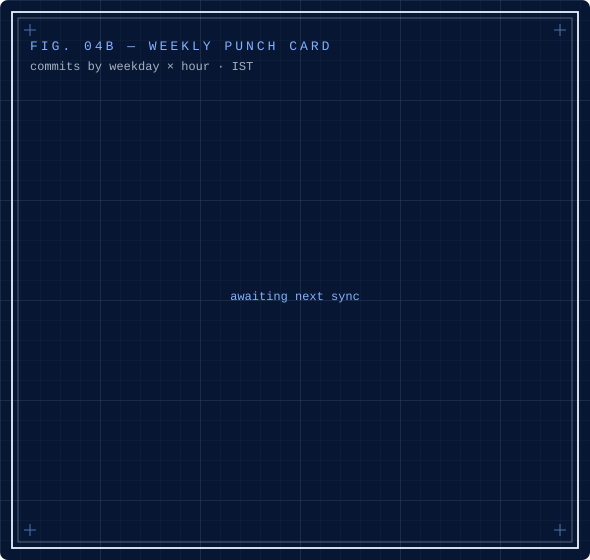
</p>

### `05` &nbsp;BILL OF MATERIALS

<p align="center">
  
</p>

### `06` &nbsp;PRODUCTS

<p align="center">
  <a href="https://moonlightdevs.com"></a>
  <a href="https://digitalweb.host"></a>
  <a href="https://diffnix.com"></a>
  <a href="https://faqvault.com"></a>
  <a href="mailto:axat.sachani@gmail.com?subject=Lakshya%20access%20request"></a>
  
</p>

<sub>● ONLINE status and the uptime bars are real — the pipeline pings every product on each run and keeps 7 days of history. Click a card to open the product.</sub>

### `07` &nbsp;PULSE · LAST 30 DAYS

<p align="center">
  
</p>

### `08` &nbsp;REFERENCE ARCHITECTURE

<p align="center">
  
</p>

### `09` &nbsp;WRITING

<!-- BLOG-POST-LIST:START -->
- **[Redis Deployments Unveiled: Practical Case Studies](https://medium.com/learn-to-earn/redis-deployments-unveiled-practical-case-studies-0c6f11eceaad)**  
  <sub>12 Oct 2026 · #deployment · #case-study · #redis</sub>
- **[What Are Wildcard SSL Certificates (And Do You Actually Need One)?](https://medium.com/learn-to-earn/what-are-wildcard-ssl-certificates-and-do-you-actually-need-one-d8a9597f386b)**  
  <sub>12 Oct 2026 · #ssl-certificate · #web-development · #security</sub>
- **[Let’s Encrypt vs Cloudflare vs Managed SSL: Which One Should You Use?](https://codeminer.medium.com/lets-encrypt-vs-cloudflare-vs-managed-ssl-which-one-should-you-use-246dc37e7181)**  
  <sub>12 Oct 2026 · #web-development · #ssl-certificate · #security</sub>
- **[Free Custom Domain Options for Developers in 2026, Compared](https://codeminer.medium.com/free-custom-domain-options-for-developers-in-2026-compared-5c823b113454)**  
  <sub>12 Oct 2026 · #web-development · #programming · #domain-names</sub>
- **[How Long Does DNS Propagation Really Take?](https://codeminer.medium.com/how-long-does-dns-propagation-really-take-18d31c956098)**  
  <sub>12 Oct 2026 · #dns · #domain-names · #web-development</sub>
- **[How to Put a Render or Railway App on a Custom Domain With HTTPS](https://codeminer.medium.com/how-to-put-a-render-or-railway-app-on-a-custom-domain-with-https-1d6402dd6d2b)**  
  <sub>12 Oct 2026 · #devops · #web-development · #domain-names</sub>
<!-- BLOG-POST-LIST:END -->

<sub>Latest articles from <a href="https://medium.com/@codeminer">Medium</a>, synced automatically.</sub>

### `10` &nbsp;GUESTBOOK

<p align="center">
  
</p>

<p align="center">
  <a href="https://github.com/AxatSachani/AxatSachani/issues/new?title=sign%3A%20hello%20from%20&body=Edit%20the%20title%20after%20%22sign%3A%22%20with%20your%20message%2C%20then%20press%20%22Submit%20new%20issue%22.%20A%20bot%20will%20add%20you%20to%20the%20guestbook%20on%20my%20profile%20in%20about%20a%20minute.">
    
  </a>
</p>

### `11` &nbsp;CONTACT

<p align="center">
  <a href="mailto:axat.sachani@gmail.com"></a>
  <a href="https://www.linkedin.com/in/akshatsachani"></a>
  <a href="https://twitter.com/akshatt_21"></a>
  <a href="https://medium.com/@codeminer"></a>
  <a href="https://dev.to/learn-to-earn"></a>
  <a href="https://stackoverflow.com/users/19117077"></a>
  <a href="https://leetcode.com/axatsachani"></a>
</p>

<details>
<summary><b>⚙ How this README works</b> — no third-party stats servers, no rate limits</summary>

<br/>

```text
 ┌──────────────┐  every 3h   ┌──────────────────┐   stats.json   ┌──────────────────┐   SVGs + README   ┌────────────┐
 │ GitHub cron  │ ──────────▶ │ scripts/fetch.py │ ─────────────▶ │ scripts/render.py│ ────────────────▶ │ /generated │
 └──────────────┘             │ GraphQL · RSS ·  │                │  pure SVG + SMIL │                   └────────────┘
                              │ uptime pings     │                └──────────────────┘
 ┌──────────────┐  on issue   ┌──────────────────┐  guestbook.json        ▲
 │ "sign: …"    │ ──────────▶ │ guestbook.py     │ ───────────────────────┘   bot replies + closes the issue
 └──────────────┘             └──────────────────┘
```

- **Zero dependencies** — Python standard library only.
- **Every animation is native SVG (SMIL)** — odometers, skyline, packets, typing — so it plays inside GitHub's image sandbox without JavaScript.
- **Privacy-safe** — private repositories are only ever counted, never named.

</details>

<p align="center">
  
</p>
