<!-- ════════════════════════════════════════════════════════════════════════
     BLUEPRINT × TERMINAL  ·  every image below is generated by this repo's own
     GitHub Action (scripts/ → generated/) and re-rendered with live data every 3h.
     ════════════════════════════════════════════════════════════════════════ -->

<p align="center">
  
</p>

<p align="center">
  
</p>

<p align="center">
  <a href="https://moonlightdevs.com"></a>
  <a href="https://www.linkedin.com/in/akshatsachani"></a>
  <a href="https://leetcode.com/axatsachani"></a>
  
</p>

### `01 //` `$ man akshat`

```diff
+ NAME
+     akshat — backend engineer · product builder · founder of Moonlight Devs

  SYNOPSIS
      akshat [--design] [--build] [--scale] [--ship] <idea>

  DESCRIPTION
      Draws the system first, then builds the part of the product nobody sees and
      everybody depends on: APIs, data models, auth & role-based access, payment
      flows, real-time pipelines, and the database migrations that hold it together.
      Runs Moonlight Devs, a product studio with three developer tools in production.

  OPTIONS
      --runtime    Node.js · NestJS · Express · TypeScript · Python
      --data       PostgreSQL · MongoDB · MySQL · Redis · RabbitMQ · GraphQL
      --infra      AWS · Cloudflare · Traefik · Firebase
      --learning   distributed systems · load balancing at scale · LLM agents

- BUGS
-     Cannot stop shipping. Known issue. Won't fix.
```

### `02 //` LIVE TELEMETRY

<p align="center">
  
</p>

<sub>↻ Numbers roll like an odometer on every page load. Level, XP and achievements are computed from real activity — locked badges unlock on their own as the numbers grow.</sub>

### `03 //` CONTRIBUTION SKYLINE

<p align="center">
  
</p>

### `04 //` CIRCADIAN PROFILE × BILL OF MATERIALS

<p align="center">
  
  
</p>

### `05 //` REFERENCE ARCHITECTURE

<p align="center">
  
</p>

### `06 //` `$ ls -la ~/products`

| perms | service | spec | status |
|:--|:--|:--|:--|
| `drwxr-xr-x` | **[diffnix/](https://diffnix.com)** | AI code review that finishes before your coffee does — security issues, leaked secrets and architecture drift, flagged on every PR in seconds. | `● LIVE` |
| `drwxr-xr-x` | **[faqvault/](https://faqvault.com)** | 4,500+ curated, verified answers across 30+ categories, searchable by meaning. Free, no paywall. | `● LIVE` |
| `drwxr-xr-x` | **[domaindock/](https://digitalweb.host)** | Free custom domains with auto-SSL, managed DNS and Traefik routing. HTTPS live in under 30 seconds. | `● LIVE` |
| `drwx------` | **solarradar/** | Open-source, real-time space-weather & aurora forecast dashboard. | `◐ BUILDING` |

### `07 //` ACTIVITY STREAM

<p align="center">
  
</p>

### `08 //` DEPLOY YOURSELF ONTO THIS PROFILE

<p align="center">
  
</p>

<p align="center">
  <a href="https://github.com/AxatSachani/AxatSachani/issues/new?title=deploy%3A%20hello%20from%20&body=Just%20hit%20%22Submit%20new%20issue%22.%20A%20GitHub%20Action%20will%20deploy%20you%20onto%20the%20board%20in%20about%20a%20minute%20%F0%9F%9A%80">
    
  </a>
  <br/><sub>Open an issue titled <code>deploy: your message</code> → a bot adds you to the board, replies, and closes the issue. Takes ~1 minute.</sub>
</p>

### `09 //` `$ git log --oneline --repos`

| commit | build | what it does | materials |
|:--|:--|:--|:--|
| `a3f9c1e` | **[Project-Management](https://github.com/AxatSachani/Project-Management)** | Team task platform — projects, assignments, auth and role-based access control | `TypeScript` `Node.js` |
| `7be2d40` | **[CodeTalk](https://github.com/AxatSachani/CodeTalk)** | Real-time chat app with a Node.js backend and native Kotlin client | `Node.js` `MongoDB` `Kotlin` |
| `1c8d5aa` | **[Algorithm-Best-Driver-Match](https://github.com/AxatSachani/Algorithm-Best-Driver-Match)** | Ride-matching engine — finds the optimal driver for a route and prices the trip | `JavaScript` |
| `e04b7f2` | **[Event-Management](https://github.com/AxatSachani/Event-Management)** | RESTful events API with a multi-image upload pipeline | `Node.js` `MongoDB` |
| `9d61e3b` | **[razorpay-node](https://github.com/AxatSachani/razorpay-node)** | Fork of Razorpay's official Node.js SDK for payment integrations | `JavaScript` |
| `5fa20c8` | **[LeetCode](https://github.com/AxatSachani/LeetCode)** | Problem-solving log — because fundamentals compound | `JavaScript` |

### `10 //` FIELD NOTES

<!-- BLOG-POST-LIST:START -->
- Latest posts appear here automatically — see [moonlightdevs.com](https://moonlightdevs.com) in the meantime.
<!-- BLOG-POST-LIST:END -->

### `11 //` `$ ssh akshat@ahmedabad`

```console
Connection established.
Hard backend problem? Diffnix for your team? Or just want to talk systems design?
```

<p align="center">
  <a href="https://www.linkedin.com/in/akshatsachani"></a>
  <a href="https://leetcode.com/axatsachani"></a>
  <a href="https://moonlightdevs.com"></a>
  <a href="https://diffnix.com"></a>
  <!-- TODO: add your real handles, then uncomment
  <a href="https://medium.com/@YOUR_HANDLE"></a>
  <a href="https://x.com/YOUR_HANDLE"></a>
  -->
</p>

<details>
<summary><b>⚙ How this README works</b> — no third-party stats servers, no rate limits, all mine</summary>

<br/>

```text
 ┌──────────────┐  every 3h   ┌──────────────────┐   stats.json   ┌──────────────────┐   9 SVGs   ┌────────────┐
 │ GitHub cron  │ ──────────▶ │ scripts/fetch.py │ ─────────────▶ │ scripts/render.py│ ─────────▶ │ /generated │
 └──────────────┘             │  GraphQL + REST  │                │  pure SVG + SMIL │            └────────────┘
 ┌──────────────┐  on issue   ┌──────────────────┐  guestbook.json        ▲
 │ "deploy: …"  │ ──────────▶ │ guestbook.py     │ ───────────────────────┘   bot replies + closes the issue
 └──────────────┘             └──────────────────┘
```

- **Zero dependencies** — Python standard library only. Runs in ~20 seconds.
- **Every animation is native SVG (SMIL)** — odometers, the skyline build-up, packets, typing — so it plays inside GitHub's image sandbox with no JavaScript.
- **Privacy-safe** — the activity stream reads only *public* events; private-repo data (if a token allows it) is only ever shown as aggregates.
- **Fork it** — edit `config.json`, push, and the pipeline rebuilds the whole profile for you.

</details>

<p align="center">
  
</p>
